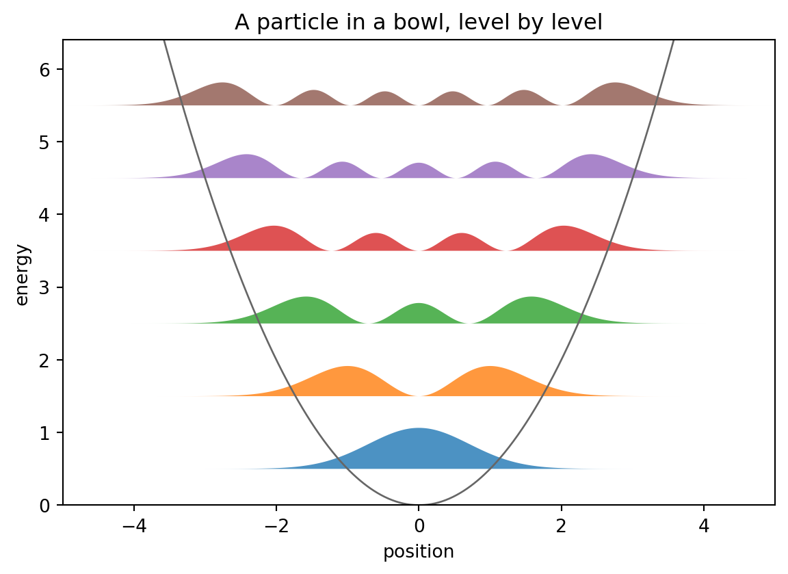
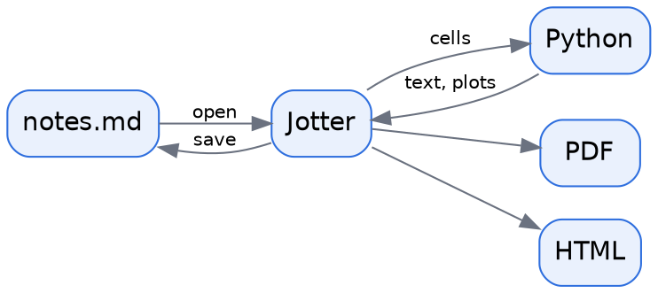
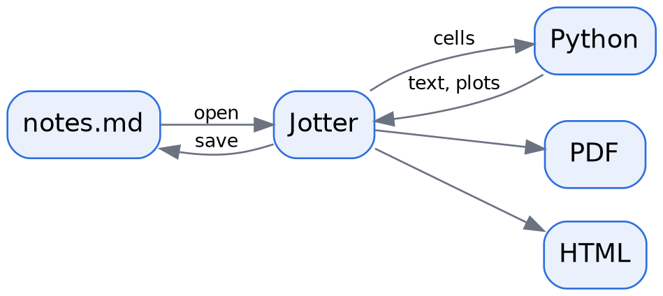
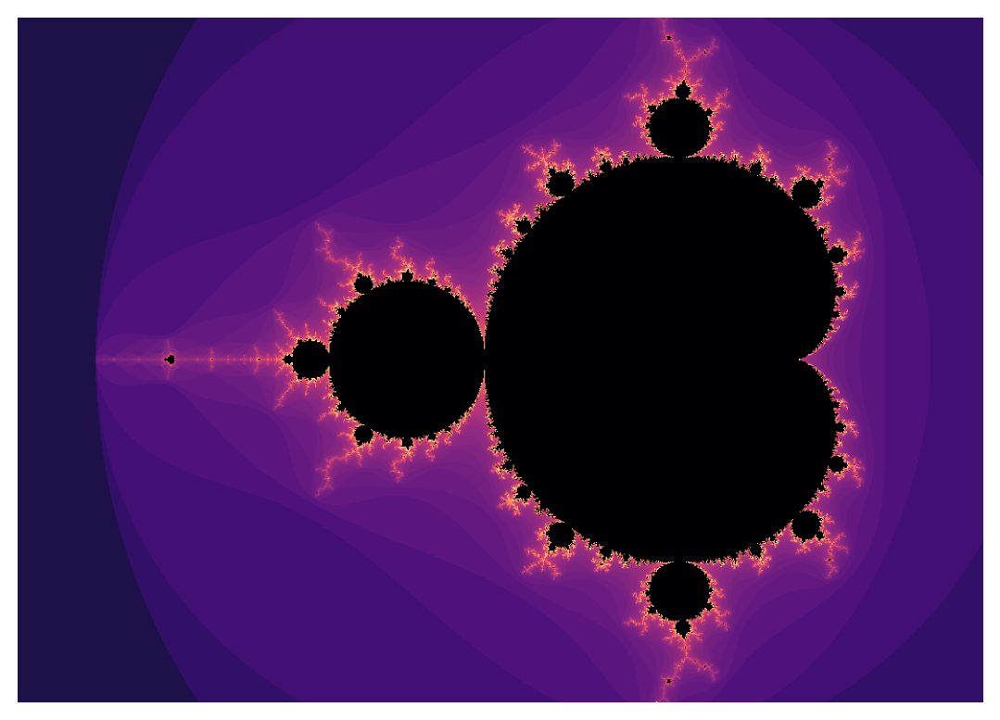

# A tour of Jotter


This is a Jotter document. It is also a plain Markdown file, and you can open it in any text editor to check. Everything on the page can be edited, and every block of code can be run.

Nothing ran when you opened it. The results under each cell were saved in the file. To run all of it again on your own machine, press **Ctrl+Shift+Enter**.

## Writing

Type the way you would in Markdown and the page formats itself as you go.

| Type this | And you get |
| --- | --- |
| `# ` at the start of a line | a heading (`## ` and `### ` for smaller ones) |
| `- ` | a bulleted list |
| `1. ` | a numbered list |
| `[] ` | a checkbox |
| `> ` | a quote |
| `---` then Enter | a rule across the page |
| `**bold**` | **bold** |
| `*italic*` | *italic* |
| `~~struck~~` | ~~struck~~ |
| `` `code` `` | `code` |
| `$x^2$` | $x^2$ |
| ```` ```python ```` then Enter | a code cell |

The toolbar and the menus do all of this too, and there is a list of keys at the end.

- Lists nest. Tab pushes an item in, Shift+Tab pulls it back out.
    - Like this one.
- Enter on an empty item ends the list.
- Links look [like this](https://commonmark.org). Ctrl+click opens one, Ctrl+K edits it.

Checkboxes are real. Click one to tick it.

- [x] Open the tour
- [ ] Run a cell
- [ ] Hide the code
- [ ] Export a PDF

> A quote looks like this. Enter on an empty line gets you out of it.

## Formulas

Type LaTeX between dollar signs and it is typeset when you close them: $e^{i\pi} + 1 = 0$ sits in the line like any other word. Ctrl+M opens a box to write a longer one in, with the result shown underneath as you type. Double-click any formula to change it.

Big ones get a line to themselves:

$$
i\hbar \frac{\partial}{\partial t} \Psi(\mathbf{r}, t) = \left[ -\frac{\hbar^2}{2m} \nabla^2 + V(\mathbf{r}, t) \right] \Psi(\mathbf{r}, t)
$$

Where LaTeX is installed the formulas are set by LaTeX itself, so matrices and aligned equations work:

$$
\begin{aligned} \nabla \cdot \mathbf{E} &= \frac{\rho}{\varepsilon_0} & \nabla \times \mathbf{E} &= -\frac{\partial \mathbf{B}}{\partial t} \\ \nabla \cdot \mathbf{B} &= 0 & \nabla \times \mathbf{B} &= \mu_0 \mathbf{J} + \mu_0 \varepsilon_0 \frac{\partial \mathbf{E}}{\partial t} \end{aligned}
$$

Where it is not, Jotter draws ordinary formulas on its own, and only those last two kinds need the real thing.

## Code that runs

Type ```` ```python ```` and Enter, or press Ctrl+Alt+C, and you have a cell. Put the cursor in this one and press **Ctrl+Enter**, or click its triangle.

```python
import math

radius = 3
area = math.pi * radius**2
print(f"A circle of radius {radius} has an area of {area:.2f}")
```

```output
A circle of radius 3 has an area of 28.27
```

Python cells share one session per document, top to bottom, like a notebook. So `radius` is still there in the next cell. The value of a cell's last line is shown without a `print`.

```python
circumference = 2 * math.pi * radius
round(circumference, 3)
```

```output
18.85
```

A line that starts with `!` goes to the shell instead, in the folder the document lives in.

```python
!ls *.md
```

```output
README.md
tutorial.md
```

## From an equation to a picture

Here is all of it working together. Take a particle in the bowl-shaped potential $V(x) = \frac{1}{2} x^2$. In units where $\hbar = m = 1$, Schrödinger's equation for the energies it is allowed to have is

$$
-\frac{1}{2} \frac{d^2 \psi}{dx^2} + \frac{1}{2} x^2 \psi = E \psi
$$

On a grid of points the left side becomes a matrix, and the allowed energies are its eigenvalues.

```python
import numpy as np

x = np.linspace(-6, 6, 1200)
dx = x[1] - x[0]
V = 0.5 * x**2

# -1/2 d²/dx² is a tridiagonal matrix; the potential sits on the diagonal
side = np.full(x.size - 1, -0.5 / dx**2)
H = np.diag(1 / dx**2 + V) + np.diag(side, 1) + np.diag(side, -1)

E, psi = np.linalg.eigh(H)
for n in range(5):
    print(f"E{n} = {E[n]:.3f}   (theory: {n + 0.5})")
```

```output
E0 = 0.500   (theory: 0.5)
E1 = 1.500   (theory: 1.5)
E2 = 2.500   (theory: 2.5)
E3 = 3.500   (theory: 3.5)
E4 = 4.500   (theory: 4.5)
```

Theory says $E_n = n + \frac{1}{2}$, and that is what came out. The same result as a picture shows where the particle is likely to be found at each energy.

```python
import matplotlib.pyplot as plt

levels = 6
fig, ax = plt.subplots(figsize=(7, 4.6))
ax.plot(x, V, color="0.4", lw=1)
for n in range(levels):
    density = psi[:, n]**2 / dx
    ax.fill_between(x, E[n], E[n] + density, alpha=0.8)
ax.set_xlim(-5, 5)
ax.set_ylim(0, levels + 0.4)
ax.set_xlabel("position")
ax.set_ylabel("energy")
ax.set_title("A particle in a bowl, level by level")
```



Change `levels` to 10 and press Ctrl+Enter: the picture is replaced by the new one. Drag a corner of it to resize it. Ctrl+Alt+P drops in a small plot to start from.

## Other languages

Click the language tag on a cell to change what it is. Jotter runs whatever the machine already has: bash, JavaScript, C, C++, Rust, Go, Ruby, Perl, Lua, R, Lean and more. Where a tool is missing, that one kind of cell does not run and everything else carries on.

```bash
for n in 3 2 1; do echo "$n..."; done
echo "Liftoff, from $(uname -s)"
```

```output
3...
2...
1...
Liftoff, from Linux
```

```javascript
const fib = n => n < 2 ? n : fib(n - 1) + fib(n - 2);
console.log([...Array(15).keys()].map(fib).join(" "));
```

```output
0 1 1 2 3 5 8 13 21 34 55 89 144 233 377
```

A C cell is compiled and then run.

```c
#include <stdio.h>

int main(void) {
    int found = 0;
    for (int n = 2; found < 12; n++) {
        int prime = 1;
        for (int d = 2; d * d <= n; d++)
            if (n % d == 0) prime = 0;
        if (prime) { printf("%d ", n); found++; }
    }
    printf("\nThe first %d primes, by way of gcc.\n", found);
    return 0;
}
```

```output
2 3 5 7 11 13 17 19 23 29 31 37 
The first 12 primes, by way of gcc.
```

Some languages draw. This one is Graphviz, and gnuplot and Mermaid cells work the same way.





## Reports

The picture below came from a cell as well, but its code is hidden. Double-click the small pill above the picture to see how it was made, or put the cursor on it and press Ctrl+Shift+H.

<!--cell python
import numpy as np
import matplotlib.pyplot as plt

re, im = np.meshgrid(np.linspace(-2.25, 0.85, 1000), np.linspace(-1.1, 1.1, 710))
c = re + 1j * im
z = np.zeros_like(c)
steps = np.zeros(c.shape)
for _ in range(90):
    inside = np.abs(z) <= 2
    z[inside] = z[inside]**2 + c[inside]
    steps[inside] += 1
steps[inside] = 0

plt.figure(figsize=(7, 5))
plt.axis("off")
plt.imshow(steps**0.45, cmap="magma")
-->



**Hide All Code** on the toolbar does that to every cell at once, which turns a notebook into a report. Ctrl+P then makes a PDF of it, and File > Export as HTML makes one web page with the pictures inside it.

## When a cell fails

```python
def average(values):
    return sum(values) / len(values)

average([])
```

```error
Traceback (most recent call last):
  File "<cell 7>", line 4, in <module>
    average([])
  File "<cell 7>", line 2, in average
    return sum(values) / len(values)
           ~~~~~~~~~~~~^~~~~~~~~~~~~
ZeroDivisionError: division by zero
```

The traceback names your lines and nothing of Jotter's. An error also stops the cells queued behind it, which is why this one is last. Ctrl+. stops a cell that is taking too long, and Cell > Restart Python forgets every variable.

## Pictures and tables

Paste a picture from the clipboard or drop a file on the page. Drag its corner to resize it, and right-click for Original Size. Pictures are saved beside the document, here in `tutorial.assets/`.

Insert > Table makes a table. Tab walks its cells and adds a row at the end, and right-click adds or removes rows and columns.

## The file

Save, and what lands on disk is ordinary Markdown.

````markdown
```python
print(6 * 7)
```

```output
42
```


<!--cell python
plt.plot(x, y)
-->

$e^{i\pi} = -1$
````

A cell is a fenced code block, what it printed is an `output` block after it, a figure is a picture, and a hidden cell is a comment. So a document diffs cleanly in git, shows up properly on any site that renders Markdown, and can still be read by a person with nothing but a text editor.

It goes the other way too. Any `.md` file opens as a document. File > Import, or dropping the file on the page, pulls one into the document you are in, and Edit > Paste Markdown does the same for Markdown on the clipboard.

## Keys

| Key | What it does |
| --- | --- |
| Ctrl+Enter | run the cell |
| Shift+Enter | run it and move on |
| Ctrl+Shift+Enter | run every cell |
| Ctrl+. | stop |
| Ctrl+Alt+C | new code cell |
| Ctrl+Alt+P | new plot |
| Alt+Enter | new paragraph below the cell or table you are in |
| Ctrl+Shift+H | hide or show a cell's code |
| Ctrl+M | formula |
| Ctrl+K | link |
| Ctrl+E | inline code |
| Ctrl+Alt+1, 2, 3 | headings |
| Ctrl+Alt+0 | body text |
| Ctrl+Shift+Q | quote |
| Ctrl+Shift+8, 7, 9 | bullets, numbers, checklist |
| Ctrl+\\ | clear formatting |
| Ctrl+F, Ctrl+H | find, replace |
| Ctrl+Shift+V | paste as plain text |
| Ctrl+Alt+V | paste Markdown |
| Ctrl+P | export PDF |
| Ctrl+=, Ctrl+-, Ctrl+0 | zoom in, out, actual size |

Also in the View menu: Dark Paper, and Check Spelling, which offers its suggestions on right-click. The word count is at the bottom of the window, and it counts the selection when there is one.

Now delete all of this and write something.
